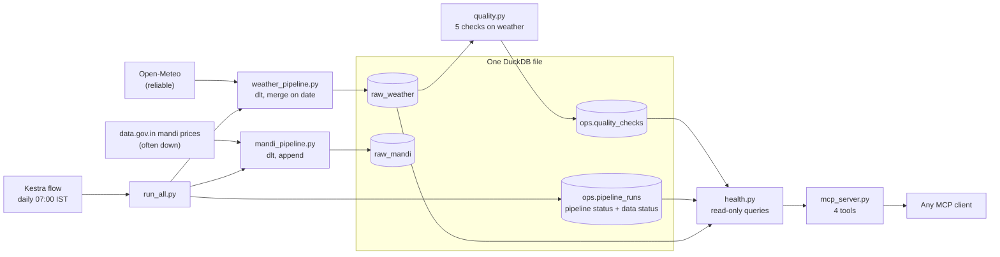

# MandiMind

[](https://github.com/Hemanth4994/MandiMind/actions/workflows/ci.yml)

A small data platform that watches itself. Two feeds (weather for Bengaluru, and commodity prices from Indian mandis) are loaded into DuckDB with dlt. After each load, quality checks look at the stored data, and every run is recorded with two separate statuses: did the pipeline run, and is the data good? An MCP server lets an AI client ask questions such as "which checks failed?" and "why did this run go wrong?". The data is only the workload; the point is the monitoring around it.

## How it fits together



`run_all.py` loads weather, then mandi (each in its own try/except, so one failing feed does not stop the other), checks the weather data, and writes one row per source to `ops.pipeline_runs`. Error text is cut to 300 characters and the API key is scrubbed out of it before it is stored.

## Two statuses, on purpose

A job can finish successfully and still load bad data. So each row in `ops.pipeline_runs` has both:

| pipeline_status | data_status | Meaning |
|---|---|---|
| success | ok | Loaded, and every check passed |
| success | bad | Loaded, but a check failed ("green but wrong"); `failed_checks` names which |
| failed | not_checked | The source failed (for example HTTP 502 or a timeout); the error is stored |
| skipped | ok / bad | Ingestion was skipped (`--no-ingest`); the stored data was still checked |

The weather checks (`pipelines/quality.py`): **freshness** (latest day is today), **completeness** (all of the last 8 days exist), **valid_temperature** (max at most 55, min at least -10, min not above max), **valid_rain** (0 to 500 mm) and **no_nulls**. The mandi feed is not checked yet.

## Breaking the data on purpose

`python pipelines/inject_fault.py gap|spike|nulls` damages the stored weather (deletes yesterday / sets today's maximum to 99 / nulls today's rain). Each fault should trip exactly one check: `gap` trips completeness, `spike` trips valid_temperature, `nulls` trips no_nulls. The tests assert exactly that. Setting `FAULT_MODE=spike` or `nulls` injects the same faults at the source, before loading.

## MCP server

`python pipelines/mcp_server.py` serves four read-only tools over stdio (the connection is opened read-only, so a tool cannot change the data):

- `get_recent_runs(limit)`: recent runs with both statuses
- `get_failed_checks(limit)`: recent failed quality checks
- `get_weather(days)`: stored weather rows
- `diagnose_run(run_id)`: statuses, error text, checks and a failure class (`upstream_unavailable`, `data_quality`, `pipeline_error` or `healthy`)

It reads `data/mandimind_weather.duckdb` by default, which is where the Kestra runs write. For a database somewhere else, such as a local run in the project folder, set `MANDIMIND_DB` to its path.

## Run it

```bash
python -m venv .venv && .venv\Scripts\activate          # Windows (use source .venv/bin/activate on Linux or macOS)
pip install -r requirements-run.txt "mcp[cli]>=2,<3"
python pipelines/run_all.py                              # load, check, record
python pipelines/show_runs.py                            # the last 10 recorded runs
```

The weather feed needs no key. The mandi feed needs `DATA_GOV_API_KEY` and `MANDI_RESOURCE_ID` in a git-ignored `.env`; without them that source simply fails and the failure is recorded.

**Kestra.** `kestra/docker-compose.yml` starts Kestra and Postgres on http://localhost:8081 (development settings: default passwords, never expose it to the internet). Start it with `docker compose -f kestra/docker-compose.yml up -d --pull never`. `kestra/flows/mandimind_run.yml` is a copy of the flow: it clones this repo, installs `requirements-run.txt` in a Python container and runs `run_all.py` against a mounted `data/` folder, with a daily 07:00 India-time trigger. Kestra's clock is UTC, so the trigger sets the timezone.

## Tests

```bash
pip install -r requirements-run.txt "mcp[cli]>=2,<3" pytest
python -m pytest -q
```

The 25 tests need no network and no API key. They cover each quality check and each injected fault, the run recorder (using `--no-ingest`), the failure classes, that the queries cannot write, and the MCP server itself, started as a separate process and called over stdio. They do not cover the live loads from the two APIs or the Kestra flow. GitHub Actions runs them on every push.

## What is not built yet

- The mandi source has returned only errors so far (HTTP 502 and timeouts since 2026-11-07), so there are no mandi rows and no mandi checks yet; its column names are unknown.
- The AI on-call agent (retrieval over run history and runbooks, a LangGraph agent, evaluations) is planned, not built. The MCP server is the layer it would use.
- dbt models, deployment on AWS with Terraform, and alerting when a run is green but wrong are not done.
